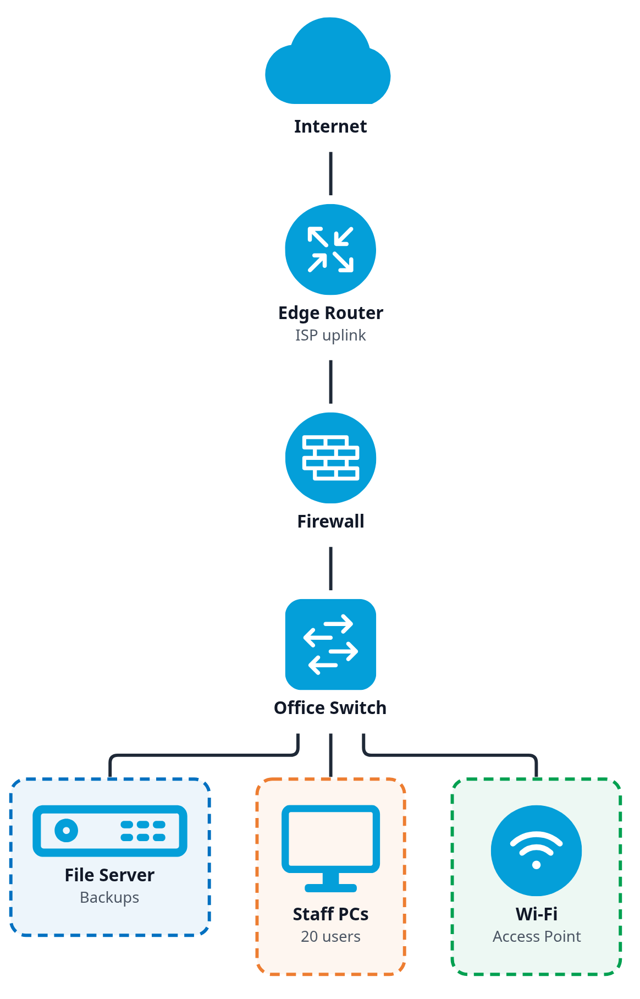
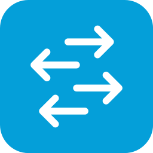
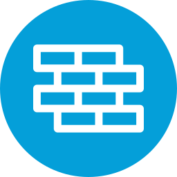
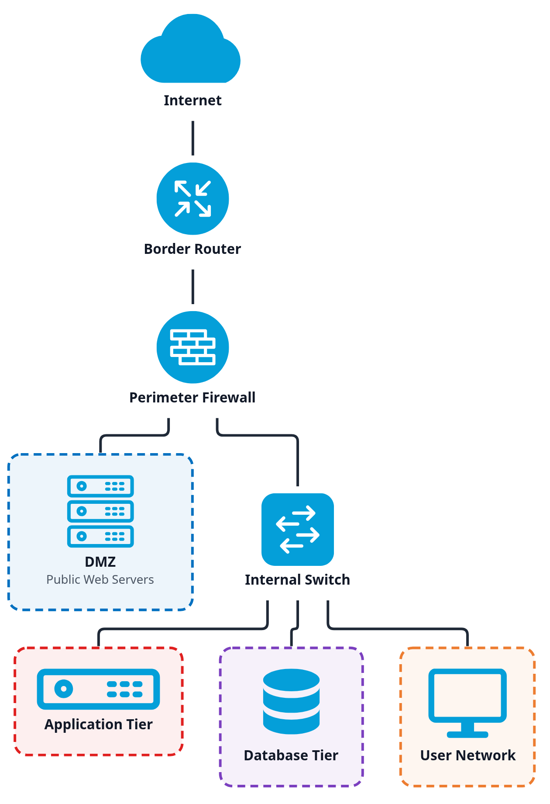
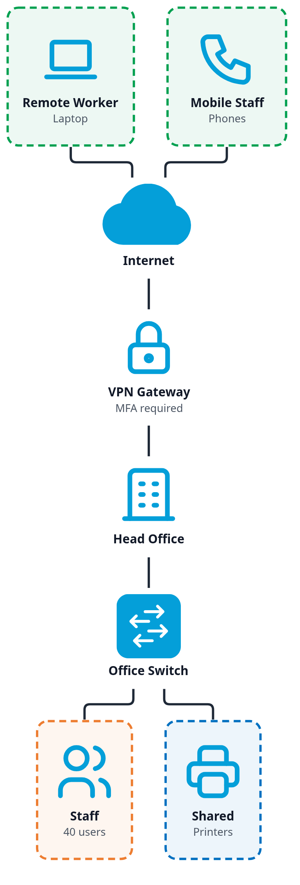

<h1 align="center">network-topology-diagrams</h1>

<p align="center">
  <b>Draw clean, Cisco-style network diagrams from a few lines of text.</b><br>
  Write the topology, get a polished SVG or PNG with icons, captions and coloured zones.
</p>

<p align="center">
  
  
  
  
</p>

<p align="center">
  
</p>

- **Text in, diagram out.** Diagrams are plain-text files you can keep in git and diff.
- **No drawing skills needed.** Icons, spacing and colours are handled for you.
- **Use it anywhere.** SVG and PNG open in browsers, Word, slides, LaTeX, [Typst](https://typst.app/) and more.
- **Open and free.** MIT code and openly licensed icons. Nothing to sign up for, nothing leaves your machine.

[Install](#1-install) · [Your first diagram](#2-your-first-diagram) · [Cheat sheet](#3-cheat-sheet) · [Icons](#icons) · [Examples](#examples) · [Troubleshooting](#troubleshooting)

---

## 1. Install

You need two free tools (check with `node --version` and `python3 --version`):

| Tool | Version | Get it |
| --- | --- | --- |
| Node.js | 22.13 or newer | [nodejs.org](https://nodejs.org/) |
| Python | 3.9 or newer | [python.org](https://www.python.org/downloads/) (Windows) or your package manager |

<details open>
<summary><b>Linux / macOS</b></summary>

```sh
git clone https://github.com/lurkzies/network-topology-diagrams.git
cd network-topology-diagrams
npm install        # downloads the renderer (about 150 MB, includes a headless browser)
```
</details>

<details>
<summary><b>Windows (PowerShell)</b></summary>

```powershell
git clone https://github.com/lurkzies/network-topology-diagrams.git
cd network-topology-diagrams
npm install
```

On Windows use `py` instead of `python3` in every command below.
</details>

That's all. There are no Python packages to install.

## 2. Your first diagram

**Step 1: copy an example.**

```sh
cp examples/small-office.mmd my-network.mmd
```

On Windows: `copy examples\small-office.mmd my-network.mmd`

**Step 2: open `my-network.mmd` in any text editor.** It looks like this (shortened):

```text
flowchart TB
    Internet@{ img: "icon:cloud", label: "Internet" }
    RTR@{ img: "icon:router", label: "Edge Router\nISP uplink" }
    FW@{ img: "icon:firewall", label: "Firewall" }
    SW@{ img: "icon:switch", label: "Office Switch" }
    PCS@{ img: "icon:pc", label: "Staff PCs\n20 users" }:::zone-orange

    Internet --- RTR
    RTR --- FW
    FW --- SW
    SW --- PCS
```

Each node line is `ID@{ img: "icon:<name>", label: "..." }`. The lines at the bottom connect nodes by ID with `---`.
Change a label, add a node, or add a connection.

**Step 3: build it.**

```sh
python3 build.py my-network.mmd           # writes my-network.svg
python3 build.py my-network.mmd -f png    # writes my-network.png
```

(On Windows, type `py` instead of `python3`.)

**Step 4: look at it.** Open the file in a web browser or image viewer
(`xdg-open my-network.svg` on Linux, `open my-network.svg` on macOS, `start my-network.svg` on Windows).

**Step 5: repeat.** Edit, rebuild, refresh. Typical builds take a few seconds.

<p align="center">
  
</p>

## 3. Cheat sheet

| I want to... | Write this |
| --- | --- |
| add a device | `ID@{ img: "icon:router", label: "Title" }` |
| add a second, grey line of detail | `label: "Title\nDetail"` (separate lines with `\n`) |
| group things in a coloured zone | add `:::zone-blue` after the node (see colours below) |
| connect two nodes | `A --- B` |
| lay the diagram out left to right | start the file with `flowchart LR` instead of `flowchart TB` |

To label a connection, put text between bars: `A ---|Encrypted<br/>Replication| B` (use `<br/>` for a line break).

Zone colours: 🟦 `blue`, 🟧 `orange`, 🟥 `red`, 🟩 `green`, 🟪 `purple`, ⬜ `gray`.
Use `---` (plain line). `-->` draws an arrowhead.
This is regular [Mermaid flowchart](https://mermaid.js.org/syntax/flowchart.html) syntax, so everything else from
Mermaid works too.

Useful commands:

```sh
python3 build.py my-network.mmd -f png -s 3    # sharper PNG (3x resolution), good for printing
python3 build.py examples/ --outdir out        # build every diagram in a folder
python3 build.py --list-icons                  # show the icon names
```

## Icons

Fifteen flat icons in Cisco blue, all under open licences (MIT or Apache-2.0). Use them as `icon:<name>`.

<table align="center">
  <tr align="center">
    <td><br><code>cloud</code></td>
    <td><br><code>router</code></td>
    <td><br><code>switch</code></td>
    <td><br><code>firewall</code></td>
    <td><br><code>lock</code></td>
  </tr>
  <tr align="center">
    <td><br><code>rack</code></td>
    <td><br><code>server</code></td>
    <td><br><code>database</code></td>
    <td><br><code>building</code></td>
    <td><br><code>ap</code></td>
  </tr>
  <tr align="center">
    <td><br><code>pc</code></td>
    <td><br><code>laptop</code></td>
    <td><br><code>phone</code></td>
    <td><br><code>printer</code></td>
    <td><br><code>users</code></td>
  </tr>
</table>

Missing one? Drop an SVG into `icons/` and use it as `icon:<its-file-name>`. See [`icons/README.md`](icons/README.md)
for how, plus the licence of each icon, and [`icons/NOTICE.md`](icons/NOTICE.md) for credits to
[Red Hat Ansible's networking-icons](https://github.com/network-automation/networking-icons) (Apache-2.0)
and [Tabler Icons](https://github.com/tabler/tabler-icons) (MIT).

## Examples

Every diagram below is built from a short source file in [`examples/`](examples/). Copy one to get started.

<table>
  <tr>
    <td align="center" width="50%">
      <br>
      <b>Small office</b><br><a href="examples/small-office.mmd"><code>small-office.mmd</code></a>
    </td>
    <td align="center" width="50%">
      <br>
      <b>Perimeter firewall with a DMZ</b><br><a href="examples/dmz.mmd"><code>dmz.mmd</code></a>
    </td>
  </tr>
  <tr>
    <td align="center">
      <br>
      <b>Head office and branch over a WAN</b><br><a href="examples/branch-and-hq.mmd"><code>branch-and-hq.mmd</code></a>
    </td>
    <td align="center">
      <br>
      <b>Remote access through a VPN gateway</b><br><a href="examples/remote-access.mmd"><code>remote-access.mmd</code></a>
    </td>
  </tr>
</table>

## Using your diagram

SVG stays sharp at any size; PNG is the safest choice for slides and Word.

- **Web, slides, Word, LaTeX:** insert the SVG or PNG like any picture.
- **Typst:** `#image("my-network.svg", width: 80%)`. See [`examples/example.typ`](examples/example.typ). For tall diagrams, set a
  height instead (`height: 20cm`) so it fits the page.
- **Markdown / GitHub:** ``.

## Make it yours

- Icon size, zone colours and the caption font are the constants at the top of [`build.py`](build.py).
- Spacing and line style are in [`mermaid.json`](mermaid.json). Keep `"htmlLabels": false`, because HTML labels
  don't render in Typst and many other SVG viewers (the build stops with an error if it finds them).

## Troubleshooting

- **`mermaid-cli not found`**: run `npm install` in this folder (needs Node.js 22.13+).
- **`Could not find chrome-headless-shell`**: the browser the renderer uses wasn't downloaded. Newer npm versions
  block dependency install scripts unless the project approves them; this repo approves puppeteer in `package.json`
  (`allowScripts`), but a global setting such as `ignore-scripts=true` can still block it. Fix it with
  `npx puppeteer browsers install chrome-headless-shell` (the command Puppeteer itself suggests) and re-run.
- **Linux: `Failed to launch the browser process` or `No usable sandbox`**: Chromium's sandbox is blocked, which is common
  in containers, as root, or on Ubuntu 23.10+ with AppArmor restrictions. mermaid-cli's
  [guidance](https://github.com/mermaid-js/mermaid-cli/blob/master/docs/linux-sandbox-issue.md) is not to run as root and to
  update your kernel. As a last resort, run with `--no-sandbox` (or set `MMDC_NO_SANDBOX=1`), which disables a security feature.
- **`unknown icon "..."`**: the message lists the valid names; check spelling with `--list-icons`.
- **Text looks different or boxes are slightly too wide or narrow**: captions use `Noto Sans`, then `Segoe UI`, `Helvetica Neue`,
  `Helvetica`, `Arial`. Install [Noto Sans](https://fonts.google.com/noto/specimen/Noto+Sans) for identical output on every machine.
- **Windows: `python` is not found**: use the `py` launcher (`py build.py ...`).
- **Arrowheads appear on lines**: use `---`, not `-->`.

## AI usage disclosure

This project was built with the help of an AI coding assistant, [Claude Code](https://claude.com/claude-code)
(Anthropic, model Claude Sonnet 5.5), working under the direction of the maintainer. The AI wrote or drafted the code
(`build.py`, `scripts/check.py`), the documentation, the example diagrams, the CI workflow and the four original icons
(`cloud`, `pc`, `database`, `ap`), and it researched and recorded the licensing of the third-party icons. It also ran the
checks described in the commit history: fresh-clone builds, `reuse lint`, and Typst rendering.

Not AI-generated: the icon artwork derived from [networking-icons](https://github.com/network-automation/networking-icons)
and [Tabler Icons](https://github.com/tabler/tabler-icons), which comes from those projects. Commits that include AI-written
work carry a `Co-Authored-By` trailer. The maintainer is responsible for what is published here. Behaviour on Windows and macOS is
verified only by the CI workflow, not by hand. If you find a mistake, please open an issue.

## Project status and what has been tested

This is an early (v0.1.0) release. Please read this before relying on it:

- **Tested by hand:** Linux only (Python 3.14, Node 26, mermaid-cli 12.2.0), including a fresh-clone install, the four examples, error
  messages, and compiling the output with Typst 0.15.1.
- **Verified by CI, not by hand:** Windows and macOS. A GitHub Actions workflow builds and checks every example on Windows, macOS and
  Ubuntu with Python 3.9 and 3.13, and compiles the Typst example. The Windows and macOS output was compared with the Linux output
  (same size, only anti-aliasing differences). The install instructions for those systems were written from documentation, so please
  report any problems.
- **Not tested:** opening the SVGs in Word, LibreOffice, Inkscape, Illustrator or other editors (use the PNG if an SVG looks wrong);
  Python versions other than 3.9 and 3.13 (CI) and 3.14 (by hand), and Node versions other than 22 (CI) and 26 (by hand); non-ASCII or space-containing paths on Windows; very long labels
  (caption width is estimated, so boxes can be a little tight or loose); and other Typst versions.
- **Limits:** plain (non-icon) Mermaid nodes keep Mermaid's default look; the Tabler-derived icons are outline style and lighter than the
  filled ones; `--no-sandbox` may be needed on Linux containers and some newer Ubuntu releases.

The software is provided as is, without warranty (see [LICENSE](LICENSE)).

## Contributing and licence

Contributions are welcome: see [CONTRIBUTING.md](CONTRIBUTING.md) and the [Code of Conduct](CODE_OF_CONDUCT.md).

Code, docs and the original icons are [MIT](LICENSE). The router, switch, firewall, server and rack icons come from
networking-icons and remain [Apache-2.0](LICENSES/Apache-2.0.txt); the Tabler-derived icons remain MIT. Details are in
[`icons/NOTICE.md`](icons/NOTICE.md), and the repo follows the [REUSE](https://reuse.software/) specification.

"Cisco" is a trademark of Cisco Systems, Inc. This project is independent, not affiliated with or endorsed by Cisco,
and uses Cisco-*style* symbols only.
