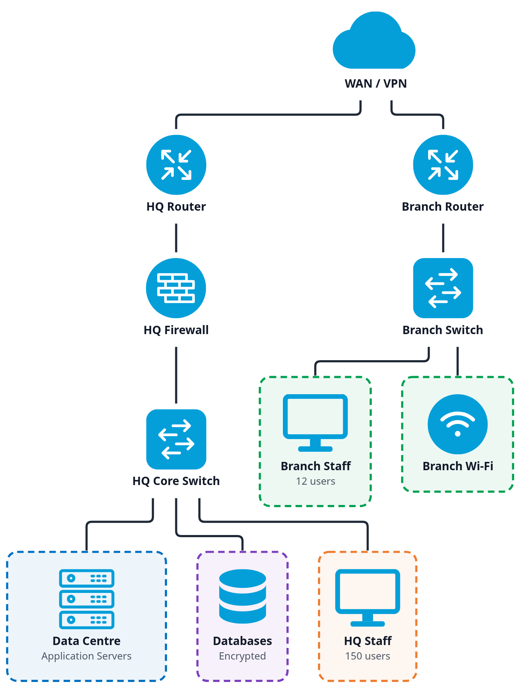

# network-topology-diagrams

Draw clean, Cisco-style network diagrams from a few lines of [Mermaid](https://mermaid.js.org/) text.
You write the topology; the tool adds flat network icons, captions and coloured zone boxes, and gives you an
SVG or PNG you can drop into Typst, LaTeX, Word, slides or a README.



```text
flowchart TB
    WAN@{ img: "icon:cloud",  label: "WAN / VPN" }
    HQR@{ img: "icon:router", label: "HQ Router" }
    HQPC@{ img: "icon:pc",    label: "HQ Staff\n150 users" }:::zone-orange

    WAN --- HQR
    HQR --- HQPC
```

## Requirements

| Tool | Version | Why |
| --- | --- | --- |
| [Node.js](https://nodejs.org/) | 22.13 or newer | runs [mermaid-cli](https://github.com/mermaid-js/mermaid-cli) (which downloads its own Chromium) |
| [Python](https://www.python.org/) | 3.9 or newer | runs `build.py` (standard library only, nothing to `pip install`) |

Works on Linux, macOS and Windows.

## Quick start

**Linux / macOS**

```sh
git clone https://github.com/<you>/network-topology-diagrams.git
cd network-topology-diagrams
npm install                                   # installs mermaid-cli
python3 build.py examples/small-office.mmd    # -> examples/small-office.svg
```

**Windows (PowerShell)**

```powershell
git clone https://github.com/<you>/network-topology-diagrams.git
cd network-topology-diagrams
npm install
py build.py examples\small-office.mmd
```

No `npm install`? `build.py` also finds a global `mmdc`, or falls back to `npx`, which downloads
mermaid-cli on first use.

Then copy an example, edit it, and rebuild:

```sh
python3 build.py my-network.mmd                 # SVG next to the source
python3 build.py my-network.mmd -f png -s 3     # PNG at 3x resolution
python3 build.py examples/ --outdir out         # every .mmd in a folder
python3 build.py --list-icons
```

## Writing a diagram

A diagram is an ordinary Mermaid `flowchart`. Declare nodes with an icon and connect them with `---`:

```text
ID@{ img: "icon:NAME", label: "Bold title\nGrey detail line" }
ID@{ img: "icon:rack", label: "DMZ\nWeb Servers" }:::zone-blue
```

- **Icons** (see [`icons/README.md`](icons/README.md)): `router` `switch` `firewall` `server` `rack` `cloud` `pc` `database` `ap`.
- **Labels**: the first line is bold, further lines are grey. Separate lines with `\n`.
- **Zones**: add `:::zone-<colour>` for a dashed, tinted box around a node. Colours: `blue` `orange` `red` `green` `purple` `gray`.
- **Links**: use `---` for plain lines. `-->` adds arrowheads, and `---|text|` adds a link label (keep it short or use `<br/>`).
- **Direction**: `flowchart TB` (top to bottom) or `LR` (left to right). Everything else in Mermaid flowcharts still works.

Plain Mermaid nodes can be mixed with icon nodes, but they won't get the Cisco look.

### Add your own icon

Put an SVG with a `viewBox` in `icons/` (for example `icons/printer.svg`) and use `icon:printer`.
Single-colour flat icons in `#049FD9` match the set. Contributed icons must be under a licence
compatible with this repo; see [CONTRIBUTING.md](CONTRIBUTING.md).

### Change the look

- Icon size, zone colours and the caption font are the constants at the top of [`build.py`](build.py).
- Layout (spacing, line style) is in [`mermaid.json`](mermaid.json). **Keep `"htmlLabels": false`**: HTML labels
  render as blank in Typst and many other SVG viewers, and the build fails if it detects them.

## Using the output in Typst

```typ
#figure(image("examples/small-office.svg", width: 70%), caption: [Small office network])
```

Tall diagrams may overflow a page at full width. Constrain the height instead, e.g. `image("x.svg", height: 20cm)`.
A working file is in [`examples/example.typ`](examples/example.typ).

## Troubleshooting

- **`mermaid-cli not found`**: run `npm install` in this folder (needs Node.js 22.13+).
- **`Could not find chrome-headless-shell`**: the browser that mermaid-cli renders with wasn't downloaded. Newer npm versions
  block dependency install scripts unless the project approves them; this repo approves puppeteer in `package.json`
  (`allowScripts`), but a global npm setting such as `ignore-scripts=true` can still block it. Fix it with
  `npx puppeteer browsers install chrome-headless-shell` (the command Puppeteer itself suggests) and re-run.
- **Linux: `Failed to launch the browser process` / `No usable sandbox`**: Chromium's sandbox is blocked, which is common
  in containers, as root, or on Ubuntu 23.10+ with AppArmor restrictions. mermaid-cli's
  [guidance](https://github.com/mermaid-js/mermaid-cli/blob/master/docs/linux-sandbox-issue.md) is not to run as root and to
  update your kernel. As a last resort, run with `--no-sandbox` (or set `MMDC_NO_SANDBOX=1`), which disables a security feature.
- **Text looks different or boxes are slightly too wide/narrow**: captions use `Noto Sans`, then `Segoe UI`, `Helvetica Neue`,
  `Helvetica`, `Arial`. Install Noto Sans for identical output across machines.
- **Windows: `python` is not found**: use the `py` launcher (`py build.py ...`).
- **Labels disappear in the SVG**: you've enabled HTML labels; see "Change the look".

## Licence

Code, documentation and the four original icons are [MIT](LICENSE). The router, switch, firewall, server and rack
icons are derived from [network-automation/networking-icons](https://github.com/network-automation/networking-icons)
and remain under the [Apache License 2.0](LICENSES/Apache-2.0.txt); see [`icons/NOTICE.md`](icons/NOTICE.md).
The repo follows the [REUSE](https://reuse.software/) specification.

"Cisco" is a trademark of Cisco Systems, Inc.; this project is independent, not affiliated with or endorsed by Cisco,
and uses Cisco-*style* symbols only.
