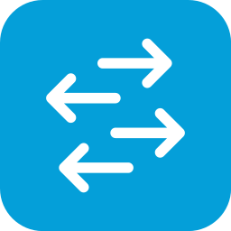
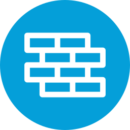

# Icons

Use any of these as `icon:<name>` in a node. Licences and changes are listed in [`NOTICE.md`](NOTICE.md).

| Preview | Name | Typical use |
| :---: | --- | --- |
|  | `router` | ISP / WAN / edge routers |
|  | `switch` | core, access and L3 switches |
|  | `firewall` | firewalls, NGFW, IPS |
|  | `server` | a single server |
|  | `rack` | server racks, server farms |
|  | `database` | databases, storage |
|  | `pc` | workstations, user networks |
|  | `ap` | wireless access points |
|  | `cloud` | Internet, WAN, cloud services |

## Adding an icon

1. Save a flat SVG as `icons/<name>.svg`. It needs a `viewBox`; names may contain letters, digits, `_` and `-`.
2. Use `#049FD9` as the main colour to match the set.
3. Add it to the table above and record its origin and licence in `NOTICE.md` and `REUSE.toml`.
